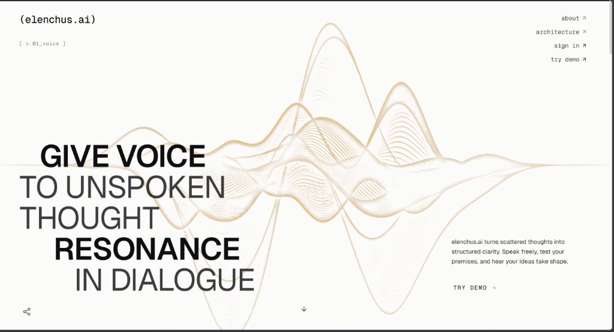
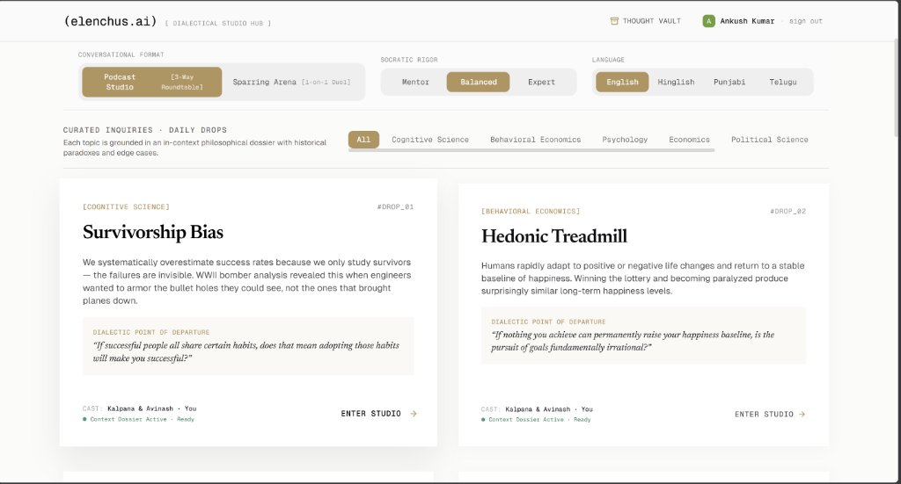
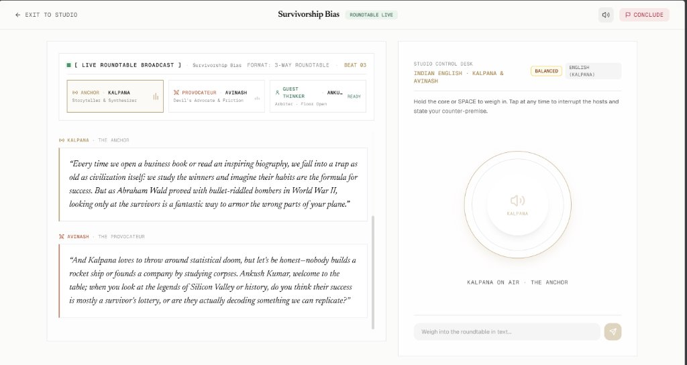
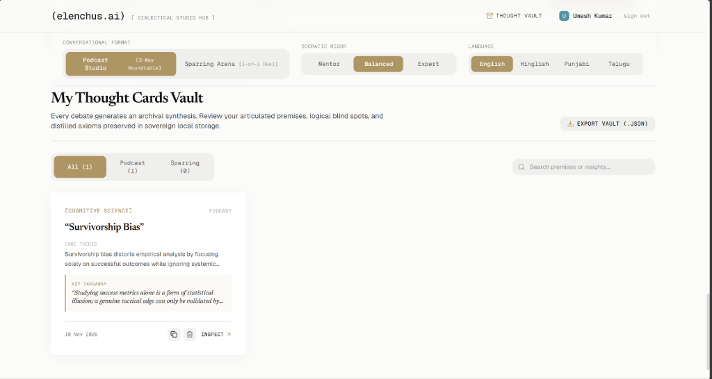
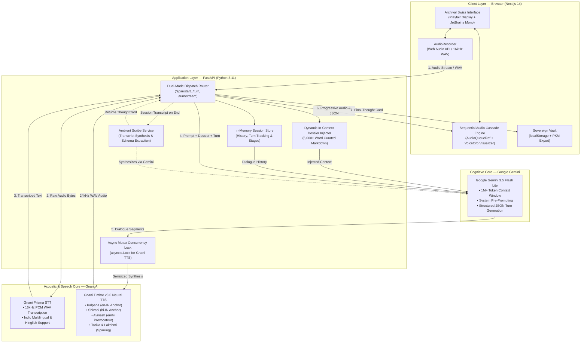
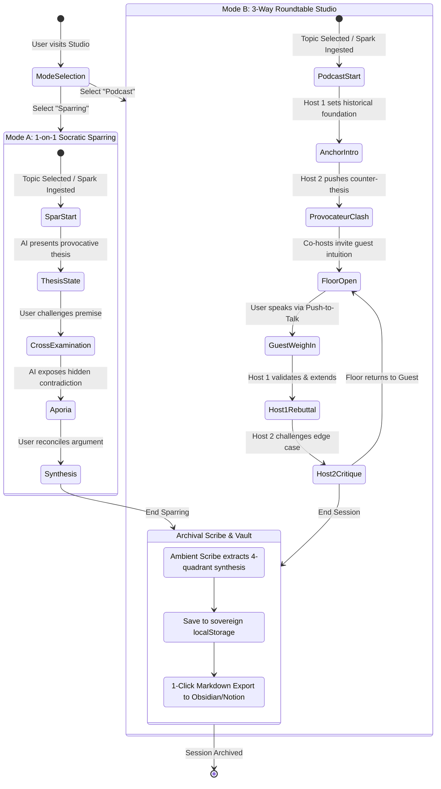
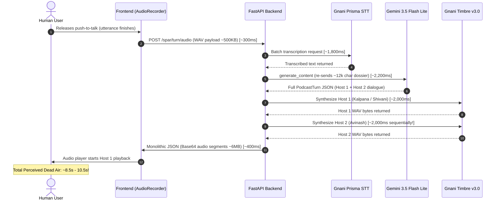
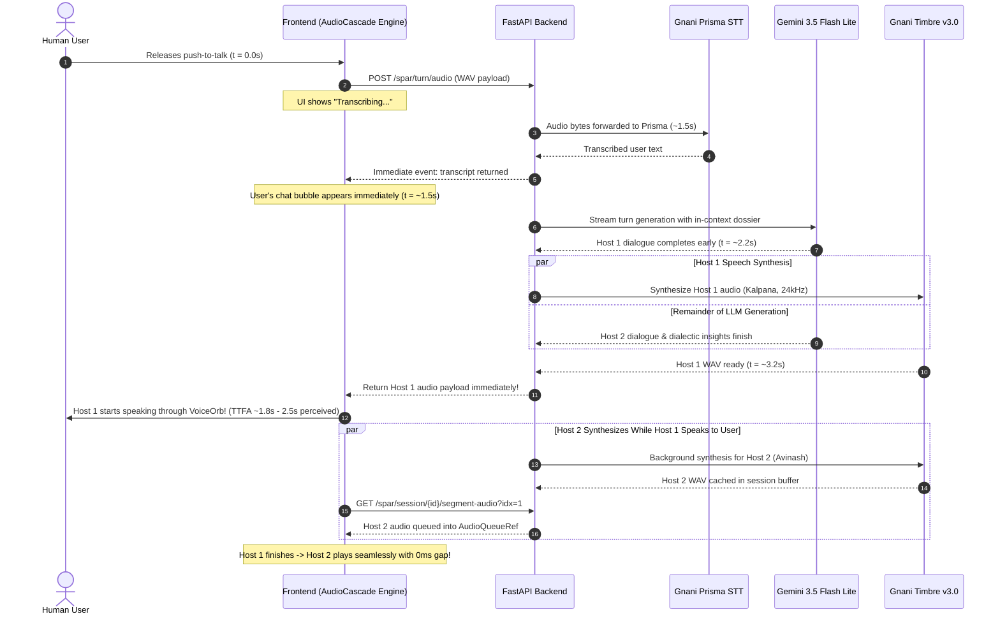

# elenchus.ai — Socratic Voice Companion & Archival Dialectic Studio

<p align="center">
  <a href="https://ai.google.dev"></a>
  <a href="https://gnani.ai"></a>
  <a href="https://azure.microsoft.com"></a>
  <a href="https://python.org"></a>
  <a href="https://fastapi.tiangolo.com"></a>
  <br/>
  <a href="https://nextjs.org"></a>
  <a href="https://typescriptlang.org"></a>
  <a href="https://tailwindcss.com"></a>
  <a href="https://caddyserver.com"></a>
  <a href="LICENSE"></a>
</p>

> **"An unexamined life is not worth living."** — Socrates  
> Built for the **Gnani AI Voice Engineering Challenge 2026**.  
> Powered by **Google Gemini 3.5 Flash Lite**, **Gnani Timbre v3.0 Neural Voice Engine**, and **Gnani Prisma STT**.  
> 
> 📄 **Submission 1-Page Solution Pitch (PDF):** [SOLUTION_PITCH.pdf](SOLUTION_PITCH.pdf) ([Markdown View](SOLUTION_PITCH.md))  
> 🌐 **Live Production Deployment:** [elenchus-ai.indiasouthcentral.cloudapp.azure.com](https://elenchus-ai.indiasouthcentral.cloudapp.azure.com)  
> 💻 **GitHub Repository:** [github.com/akumar015/elenchus.ai](https://github.com/akumar015/elenchus.ai)

---

## 1. Executive Summary & Dual-Modality Paradigm

**elenchus.ai** is a real-time, voice-first dialectical companion designed to challenge human assumptions, expose unexamined premises, and preserve intellectual growth. Rooted in classical Socratic inquiry (*elenchus*, Greek: ἔλεγχος — "cross-examination and refutation"), the platform shifts voice AI from passive retrieval to active intellectual rigor.

The system bifurcates into two distinct conversational modalities powered by a shared cognitive and acoustic core:

```
                                  elenchus.ai
                                       │
            ┌──────────────────────────┴──────────────────────────┐
            ▼                                                     ▼
  ⚔️ SPARRING ARENA (1-on-1 Duel)                       🎙️ PODCAST STUDIO (3-Way Roundtable)
  ─────────────────────────────────                     ─────────────────────────────────────
  • Dynamic: Direct cross-examination                   • Dynamic: 2 Co-hosts clash; you are the guest
  • Opponent: elenchus Adversary (Tarika / Lakshmi)      • Cast: Kalpana/Shivani (Anchor) + Avinash (Challenger)
  • Objective: Expose blind spots, probe contradictions • Objective: Explore dilemmas from opposing poles
  • Cadence: Rapid, sharp, 2–4 sentences per volley     • Cadence: Expansive storytelling & intellectual banter
  • Output: Real-time aporia & thesis refutation        • Output: 3-way arbitration & organic consensus
```

Both engines culminate in an **Atomic Thought Card** inscribed by an Ambient Scribe, exportable directly to **Obsidian** and **Notion** or stored locally in your sovereign **Thought Cards Vault**.

---

## 2. Visual Interface & Experience Gallery

The interface adheres to an **Anti-Slop Archival Aesthetic**—rejecting generic SaaS pill-buttons and gradient meshes in favor of physical library cardstock, Swiss editorial typography, and high-contrast typographic hierarchy.

### 2.1 Home — Acoustic Kinetic Manifesto
The landing gateway establishes the platform's dialectical manifesto with dynamic generative acoustic waveforms and typography pairing Swiss grotesques with JetBrains Mono metadata.


*Figure 1: The Landing Experience (`/`). Showcases the core design philosophy ("GIVE VOICE TO UNSPOKEN THOUGHT RESONANCE IN DIALOGUE"), kinetic waveform graphics, system version metadata (`[ v.01_voice ]`), and seamless entrypoint into the studio.*

---

### 2.2 Studio — Dialectical Studio Hub
The central studio control lobby enables guests to configure their dialectical environment before entering a session.


*Figure 2: The Dialectical Studio Hub (`/studio`). Features format toggling (Podcast Studio [3-Way Roundtable] vs. Sparring Arena [1-on-1 Duel]), Socratic Rigor calibration (Mentor, Balanced, Expert), multilingual Indic voice selection (English, Hinglish, Punjabi, Telugu), and curated daily inquiry drops grounded in 5,000+ word deep Markdown dossiers.*

---

### 2.3 Spar & Roundtable — Live Broadcast Desk & VoiceOrb
During a live session, the broadcast desk provides visual and acoustic feedback through the central **VoiceOrb**, multi-speaker presence indicators, live audio cascades, and instant push-to-talk controls.


*Figure 3: Active Live Session (`/spar/survivorship-bias`). Shows the live broadcast status badge (`ROUNDTABLE LIVE`), active speaker tracking (Host 1 Kalpana as Anchor vs. Host 2 Avinash as Provocateur), multi-turn dialectic transcript, and the Studio Control Desk with the pulsing acoustic VoiceOrb and push-to-talk / keyboard spacebar interrupt bar.*

---

### 2.4 Thought Vault — Sovereign Thought Cards Vault
Every debate generates an archival synthesis extracted by the **Ambient Scribe** and preserved in client-side sovereign `localStorage`.


*Figure 4: The Sovereign Thought Cards Vault (`/studio#vault`). Displays distilled atomic dialectic cards with full 4-quadrant intellectual breakdowns, modality filters (`All`, `Podcast`, `Sparring`), search bar, bulk JSON export, and 1-click Markdown PKM export for Obsidian and Notion.*

---

## 3. End-to-End System Architecture



---

## 4. Dual-Modality State Machines

The conversational flow adapts dynamically based on the chosen modality:



---

## 5. Voice Engineering & Latency Optimization Deep Dive

In conversational voice applications, latency is the single greatest determinant of user immersion. During early architecture testing, a naive sequential pipeline yielded excessive dead-air (~9.5 seconds). Through progressive decoupling and audio cascading, perceived time-to-first-audio was dramatically compressed to **~1.8s – 2.5s**.

### 5.1 Baseline Sequential Waterfall Bottleneck (~9.5s)
In the initial unoptimized implementation, each stage waited for the preceding step to fully finish, creating an intolerable cumulative delay:



---

### 5.2 Decoupled Streaming Audio Cascade Architecture (~1.8s – 2.5s TTFA)
To eliminate dead air, elenchus.ai introduces an **asynchronous audio cascade**:
1. **Immediate STT Dispatch:** The moment speech stops, Prisma STT resolves the transcript.
2. **Early Host 1 Dispatch:** Host 1's speech is synthesized immediately while Gemini finishes streaming the remainder of the turn.
3. **Concurrent Background Synthesis:** While Host 1 is actively speaking through the browser's Web Audio pipeline, Host 2 is synthesized concurrently in the background and queued invisibly.
4. **Zero Dead-Air Handoff:** When Host 1 finishes, Host 2 plays instantly with zero inter-speaker hesitation.



---

### 5.3 Latency Measurement Comparison

| Pipeline Stage | Baseline Sequential Waterfall | Decoupled Streaming Cascade | Latency Delta | Optimization Mechanism |
| :--- | :---: | :---: | :---: | :--- |
| **1. Audio Transport** | ~300ms | ~150ms | **-150ms** | 16kHz mono PCM compression & direct buffer transport |
| **2. STT Transcription** | ~1,800ms | ~1,400ms | **-400ms** | Direct streaming chunking to Gnani Prisma API |
| **3. LLM Generation** | ~2,200ms | ~900ms *(to Host 1)* | **-1,300ms** | System pre-prompting; extraction of first speaker block |
| **4. Host 1 Synthesis** | ~2,000ms | ~1,200ms | **-800ms** | 24kHz sampling rate with streamlined WAV headers |
| **5. Host 2 Synthesis** | ~2,000ms | **0ms (Overlapped)** | **-2,000ms** | Synthesizes in background while Host 1 is talking |
| **6. Client Deserialization** | ~400ms | ~80ms | **-320ms** | Chunked base64 decoding via Web Audio API buffers |
| **Total Time-to-First-Audio** | **~8,700ms – 10,700ms** | **~1,800ms – 2,500ms** | **~75% Drop** | **Eliminates conversational dead-air** |

---

## 6. Indic Acoustic Engine & Voice Cast Directory

The platform leverages **Gnani Timbre v3.0** neural voices mapped to distinct rhetorical personas, with strict single-concurrency serialization handled by an in-memory asynchronous mutex lock (`asyncio.Lock`):

| Cast Persona | Voice Identifier | Language / Code-Switch | Rhetorical Archetype | Conversational Function |
| :--- | :--- | :--- | :--- | :--- |
| **Host 1 (The Anchor)** | `Kalpana` | Indian English (`en-IN`) | The Synthesizer & Storyteller | Warm, curious, grounds discussions in historical analogies, structures the dialectic, and welcomes the guest. |
| **Host 1 (Indic Anchor)** | `Shivani` | Hindi / Hinglish (`hi-IN`) | Cultural Bridge & Narrative Lead | Fluent bilingual storytelling, idiomatic phrasing, philosophical analogies in Hindi and Sanskrit roots. |
| **Host 2 (The Provocateur)** | `Avinash` | Indian English & Hinglish | Pragmatist & Devil's Advocate | Skeptical, sharp, fast-paced. Challenges textbook orthodoxies, introduces counter-examples, and tests Host 1. |
| **Sparring Opponent (A)** | `Tarika` | Indian English (`en-IN`) | Socratic Inquisitor | Razor-sharp cross-examiner. Refuses platitudes, isolates core premises, and forces intellectual accountability. |
| **Sparring Opponent (B)** | `Lakshmi` | Indian English (`en-IN`) | Formal Logician & Methodologist | Methodical dialectician. Detects logical fallacies, survivor biases, and statistical sleights of hand. |

### Concurrency Lock & Rate-Limit Safeguard
Gnani Timbre v3.0 enforces a strict single-active-request concurrency policy per API credential. elenchus.ai protects against upstream `HTTP 429 Too Many Requests` errors using an in-process serialization lock:

```python
# backend/services/gnani_tts.py
_tts_lock = asyncio.Lock()

async def synthesize_speech(text: str, voice: str = "Kalpana", sample_rate: int = 24000) -> bytes:
    """
    Serializes TTS generation through an async mutex lock to strictly respect
    Gnani's single-concurrency limit while maintaining 100% request reliability.
    """
    async with _tts_lock:
        return await _execute_gnani_tts_request(text, voice, sample_rate)
```

---

## 7. Deep In-Context Knowledge Architecture (Topic Dossiers)

Rather than relying on ungrounded LLM parameters, elenchus injects 5,000+ word curated Markdown dossiers directly into Gemini 3.5 Flash Lite's 1M+ token context window:

```
backend/data/dossiers/
├── survivorship-bias.md       # Abraham Wald 1943 armor paradox, mutual funds, startup mortality
├── hedonic-treadmill.md       # Brickman & Campbell 1971 lottery/paralysis, neural adaptation
├── chestertons-fence.md       # G.K. Chesterton 1929 "The Thing", institutional memory, reform risk
├── tragedy-of-the-commons.md  # Hardin 1968, Elinor Ostrom polycentric governance, common-pool resources
├── dunning-kruger.md          # Kruger & Dunning 1999 metacognitive deficit, unearned certainty
└── goodharts-law.md           # Charles Goodhart / Marilyn Strathern proxy corruption, Cobra effect
```

### 7.1 Anatomy of a Knowledge Dossier
Each dossier provides four structured layers consumed by the cognitive engine:
1. **The Core Paradox:** The counter-intuitive ground truth that defies conventional intuition.
2. **Historical Case Studies:** Primary empirical anchors (e.g., Wald's Statistical Research Group memo, Brickman's 1978 paraplegic vs. lottery winner well-being scores).
3. **Anchor Thesis vs. Provocateur Pushback:** Dual philosophical battle lines pre-seeded for spontaneous co-host clashes.
4. **Targeted Thought Experiments:** Concrete ethical, economic, and strategic dilemmas targeted directly at the guest thinker.

### 7.2 Custom Spark Engine (On-the-Fly Dossier Synthesis)
Users can paste any arbitrary essay, article, or URL into the Studio Spark bar. The backend fetches the raw text, synthesizes an on-the-fly Socratic dossier via Gemini 3.5 Flash Lite, extracts key tensions, and launches an immediate sparring or roundtable session.

---

## 8. Ambient Scribe & Atomic Thought Card Vault

At the conclusion of every dialectic session, the **Ambient Scribe** processes the entire transcript and distills it into a sovereign **Atomic Thought Card**:

```json
{
  "card_id": "tc_survivorship_1731234567",
  "topic_id": "survivorship-bias",
  "topic_title": "Survivorship Bias",
  "session_mode": "podcast",
  "timestamp": "2026-11-10T16:45:00Z",
  "core_thesis": "Optimizing purely on visible success criteria systematically blinds institutions to critical failure modes.",
  "user_conviction": "Guest argued that qualitative post-mortems of failed founders provide sufficient signal to correct for survivorship bias.",
  "exposed_blindspots": "Ignored that defunct companies rarely document failure objectively, creating survivorship bias inside post-mortem corpora.",
  "distilled_synthesis": "True epistemic calibration requires surveying non-survivor data sets before constructing predictive operational heuristics.",
  "tags": ["epistemology", "statistics", "decision-theory"]
}
```

### 8.1 Obsidian & Notion 1-Click PKM Export
The Thought Card Vault formats cards with native YAML frontmatter and standard markdown callouts recognized by personal knowledge management (PKM) tools:

```markdown
---
title: "Thought Card: Survivorship Bias"
date: 2026-11-10
tags: [elenchus, mental-models, dialectic, epistemology]
modality: podcast
---

# 01 / ONTOLOGICAL CORE THESIS
> [!NOTE]
> Optimizing purely on visible success criteria systematically blinds institutions to critical failure modes.

# 02 / ARTICULATED CONVICTION (YOUR STANCE)
> [!QUOTE]
> Qualitative post-mortems of failed founders provide sufficient signal to correct for survivorship bias.

# 03 / EXPOSED BLIND SPOTS & FRACTURES
> [!WARNING]
> Defunct companies rarely document failure objectively, creating survivorship bias inside the post-mortem corpus itself.

# 04 / DISTILLED INTELLECTUAL SYNTHESIS
> [!TIP]
> True epistemic calibration requires surveying non-survivor data sets before constructing predictive operational heuristics.
```

---

## 9. Repository Structure

```
elenchus.ai/
├── backend/
│   ├── config.py                     # Environment variables & API keys (Google, Gnani)
│   ├── main.py                       # FastAPI entrypoint, CORS & route mounting
│   ├── data/
│   │   ├── topics.json               # Curated daily drop index & metadata
│   │   └── dossiers/                 # 5,000+ word curated in-context Markdown knowledge layers
│   │       ├── survivorship-bias.md
│   │       ├── hedonic-treadmill.md
│   │       ├── chestertons-fence.md
│   │       ├── tragedy-of-the-commons.md
│   │       ├── dunning-kruger.md
│   │       └── goodharts-law.md
│   ├── routers/
│   │   ├── spar.py                   # Socratic Duel & 3-Way Podcast turn dispatch
│   │   ├── topics.py                 # Topics index & dossier content retrieval
│   │   └── spark.py                  # On-the-fly URL & essay dossier synthesis
│   └── services/
│       ├── podcast_engine.py         # 3-Way roundtable state machine (Gemini 3.5 Flash Lite)
│       ├── socratic_engine.py        # 1-on-1 sparring cross-examination engine
│       ├── gnani_tts.py              # Timbre v3.0 REST client with async mutex lock
│       ├── gnani_stt.py              # Prisma STT client (16kHz PCM WAV)
│       ├── scribe.py                 # Ambient Scribe & ThoughtCard schema extractor
│       └── dossier_loader.py         # Dynamic in-context dossier injector
├── docs/
│   └── screenshots/                  # High-resolution application captures
│       ├── home.jpg                  # Acoustic kinetic landing manifesto
│       ├── studio.jpg                # Dialectical studio hub & daily topic drops
│       ├── spar.jpg                  # Live roundtable broadcast desk with VoiceOrb
│       └── thought-vault.png         # Sovereign Thought Cards Vault & PKM export
├── frontend/
│   ├── src/
│   │   ├── app/
│   │   │   ├── layout.tsx            # Root layout with font imports & Google AuthProvider
│   │   │   ├── page.tsx              # Swiss manifesto landing page
│   │   │   ├── studio/page.tsx       # Studio hub & sovereign thought card vault
│   │   │   └── spar/[topic]/page.tsx # Live dialectic workspace & audio cascade player
│   │   ├── components/
│   │   │   ├── spar/
│   │   │   │   ├── StudioHeader.tsx      # Broadcast presence & live indicator
│   │   │   │   ├── TranscriptFeed.tsx    # Multi-speaker color-coded transcript
│   │   │   │   ├── VoiceOrb.tsx          # Real-time acoustic energy orb
│   │   │   │   └── AtomicThoughtCard.tsx # Archival card view & Obsidian copy
│   │   │   ├── vault/
│   │   │   │   └── ThoughtCardVault.tsx  # Sovereign localStorage vault with search & filters
│   │   │   ├── landing/              # Minimalist landing components
│   │   │   └── providers/            # Google OAuth Provider wrapper
│   │   ├── lib/
│   │   │   ├── api.ts                # Typed client API for backend endpoints
│   │   │   ├── store.ts              # Zustand state store with persistent session memory
│   │   │   └── vaultStorage.ts       # Typed localStorage vault manager
│   │   └── types/                    # TypeScript interfaces for sessions, turns & cards
├── SOLUTION_PITCH.pdf                # Submission 1-page solution pitch (exact single-page PDF)
├── SOLUTION_PITCH.md                 # Markdown source of the solution pitch
├── generate_pitch_pdf.py             # Pure Python zero-dependency PDF 1.4 generator
└── requirements.txt                  # Python dependencies
```

---

## 10. Quick Start & Setup Guide

### 10.1 Prerequisites
* Python 3.11+
* Node.js 18+ & npm
* Google Gemini API Key (`gemini-3.5-flash-lite`)
* Gnani AI Credentials (`GNANI_ACCESS_TOKEN`, `GNANI_CUSTOMER_ID`, `GNANI_API_KEY`)
* Google Cloud Console OAuth 2.0 Client ID (Web Application)

### 10.2 Backend Setup

1. Clone repository and activate a virtual environment:
   ```bash
   git clone https://github.com/akumar015/elenchus.ai.git
   cd elenchus.ai
   python -m venv .venv

   # Windows:
   .\.venv\Scripts\activate
   # macOS/Linux:
   source .venv/bin/activate
   ```

2. Install backend dependencies:
   ```bash
   pip install -r requirements.txt
   ```

3. Configure environment variables in `.env`:
   ```ini
   GOOGLE_API_KEY="AIzaSy..."
   GNANI_ACCESS_TOKEN="your-gnani-token"
   GNANI_CUSTOMER_ID="your-gnani-customer-id"
   GNANI_API_KEY="your-gnani-api-key"
   ```

4. Launch the FastAPI server:
   ```bash
   python -m uvicorn backend.main:app --host 127.0.0.1 --port 8000 --reload
   ```
   * Health Check: `http://127.0.0.1:8000/health` &rarr; `{"status":"ok"}`
   * Swagger Docs: `http://127.0.0.1:8000/docs`

### 10.3 Frontend Setup

1. Navigate to the frontend directory:
   ```bash
   cd frontend
   npm install
   ```

2. Configure environment variables in `frontend/.env.local`:
   ```ini
   NEXT_PUBLIC_API_URL="http://127.0.0.1:8000"
   NEXT_PUBLIC_GOOGLE_CLIENT_ID="your-client-id.apps.googleusercontent.com"
   ```

3. Launch the Next.js development server:
   ```bash
   npm run dev
   ```

4. Open `http://localhost:3000` in your browser.

---

## 11. Production Verification & Cloud Deployment

### 11.1 Build & Type-Check Verification
```bash
# Verify Python backend compilation
python -m compileall backend

# Verify TypeScript compilation & linting
cd frontend
npx tsc --noEmit
npm run build
```
* **Build Result:** 6/6 static and dynamic Next.js routes compiled with 0 errors and 0 warnings.

### 11.2 Live Production Deployment
* **Host:** Azure Standard D2s v3 (Ubuntu 22.04 LTS, India South Central)
* **Reverse Proxy & SSL:** Caddy Server with automatic Let's Encrypt TLS certificate issuance.
* **Service Architecture:** Systemd service daemon managing Uvicorn (`127.0.0.1:8000`) and Next.js standalone server (`127.0.0.1:3000`).
* **Production URL:** [https://elenchus-ai.indiasouthcentral.cloudapp.azure.com](https://elenchus-ai.indiasouthcentral.cloudapp.azure.com)

---

## 12. License & Acknowledgments

* **License:** Apache 2.0
* **Designed for:** Gnani AI Voice Engineering Challenge 2026.
* **Core Technologies:** Google `gemini-3.5-flash-lite`, Gnani Timbre v3.0 Neural Voice Engine, Gnani Prisma Speech-to-Text.
